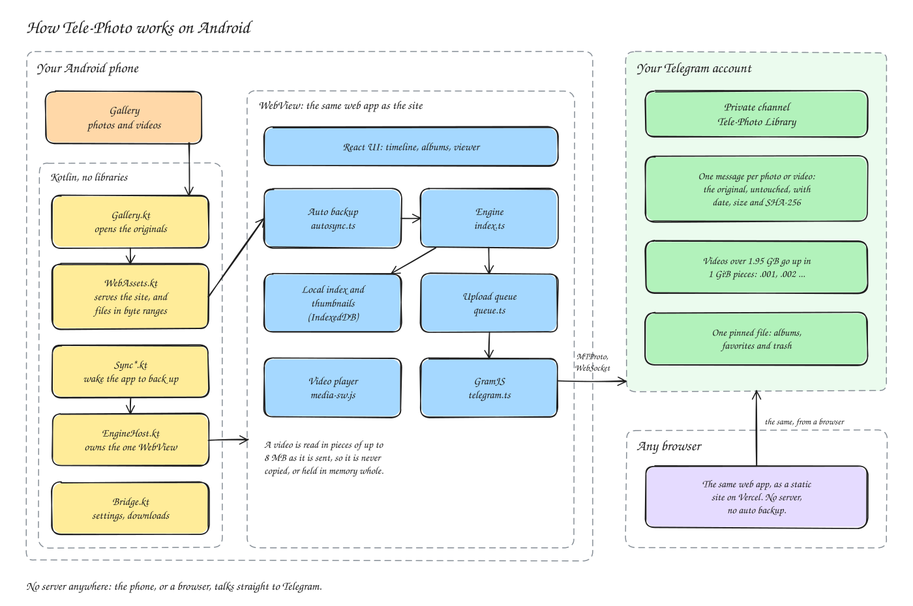
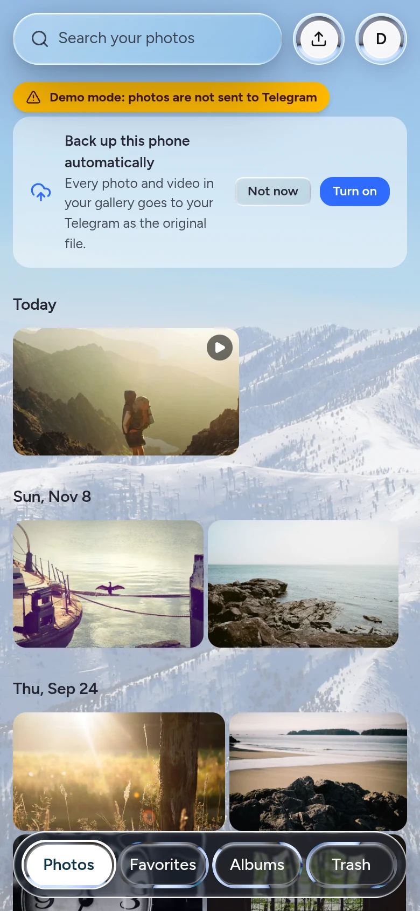
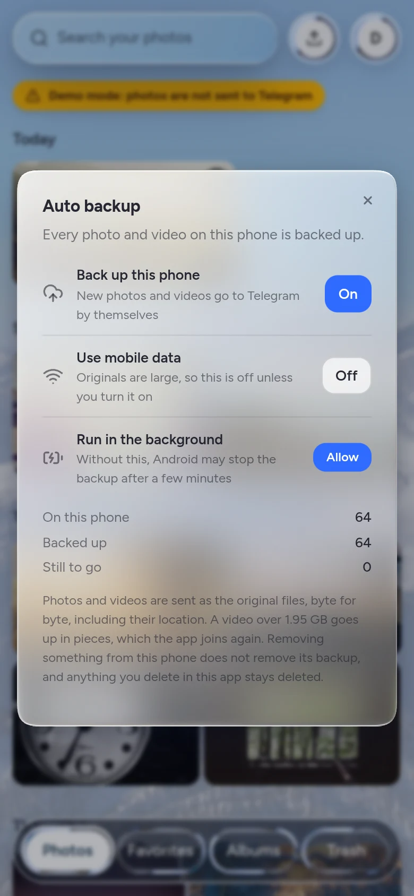
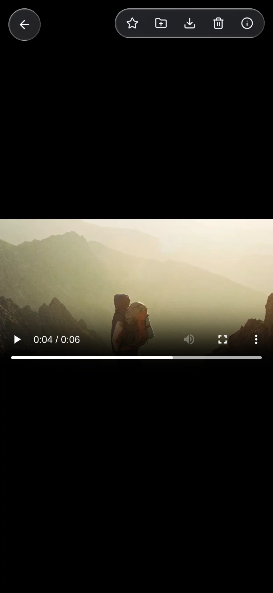
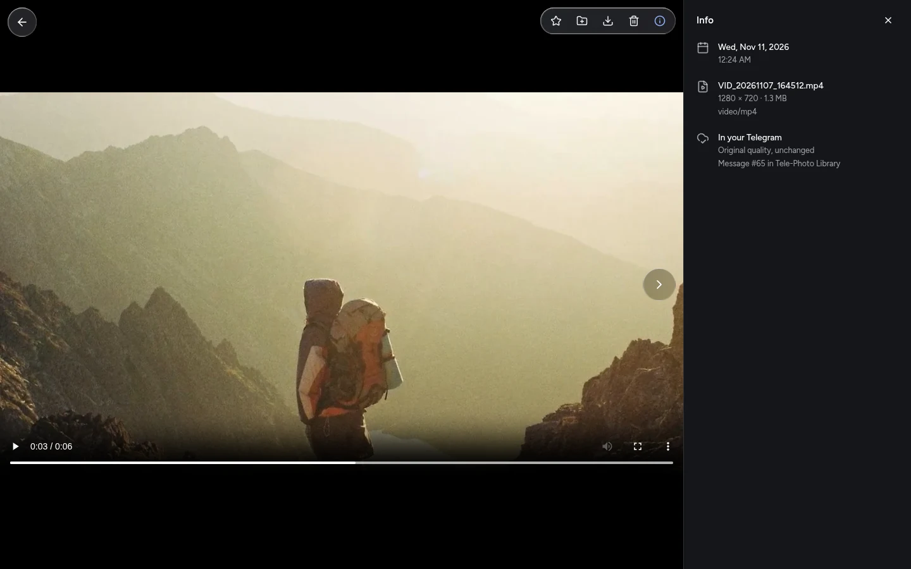
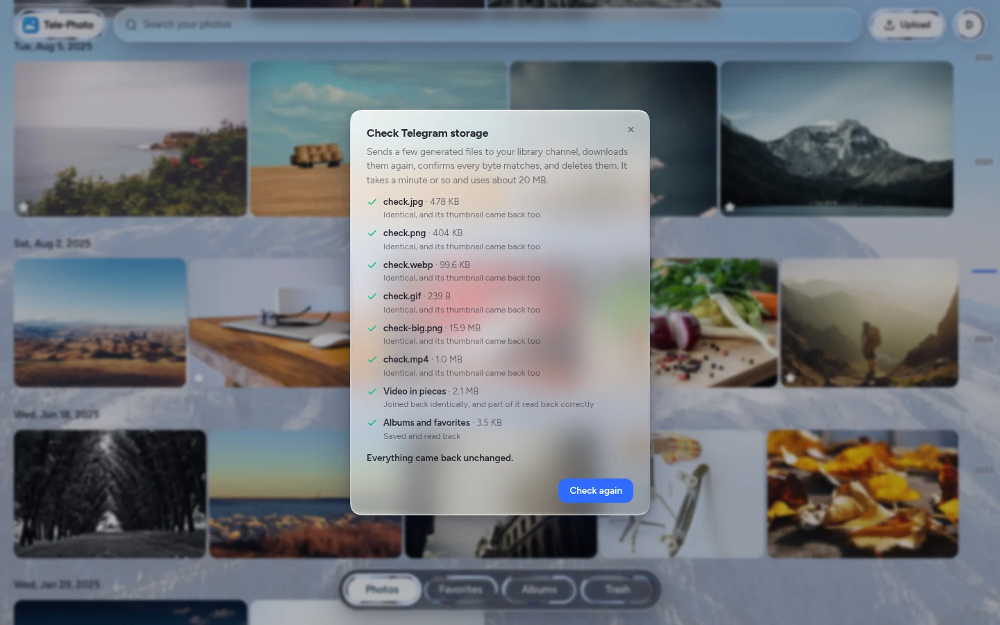

# Tele-Photo for Android

A Google Photos alternative that keeps your originals in your own Telegram account, at full quality, and backs up your phone's gallery by itself.

You sign in with your Telegram phone number. Tele-Photo creates a private channel on your account called **Tele-Photo Library** and stores each photo and video there as untouched files. A timeline, albums, favorites, search and a trash all run on top of it, in a liquid glass interface.

There is no server. The phone talks straight to Telegram, so nobody else ever holds your login or your photos. The same code also builds a website, see [The website](#the-website).


[See all the screenshots](#screenshots)

> [!WARNING]
> **The app has not been tried on a phone yet.** The backup logic has automated tests, including reading photos and videos from a pretend phone, and the Android code compiles and passes Android's lint checks. None of it has run on a real phone. Start with the demo build, then try your real account with a few photos and videos, and run **Check Telegram storage** from the account menu before relying on it.

## What the app does

- **Everything the website does:** browse, search, albums, favorites, trash and uploads. Downloads go to the phone's Downloads folder.
- **Auto backup** of the gallery, photos and videos, as the original files. See [How auto backup works](#how-auto-backup-works).
- **Videos** play in the app and can seek straight away, without downloading the whole file first, and the player's fullscreen button fills the screen. A video over 1.95 GB is stored in pieces and joined again when you play or download it.

It needs Android 10 or newer.

## Get the app

There is no ready-made APK to download, because the app has to be built with your own Telegram API key.

### 1. Build it

You need [Android Studio](https://developer.android.com/studio) for its SDK and Java, plus Node 22 or newer and [pnpm](https://pnpm.io).

1. Go to [my.telegram.org/apps](https://my.telegram.org/apps), sign in, and create an app. Any name works. Keep the **api_id** and **api_hash** it gives you.
2. Then run:

```bash
pnpm install
cp .env.example .env     # then fill in VITE_TELEGRAM_API_ID and VITE_TELEGRAM_API_HASH
pnpm android:apk         # android/dist/Tele-Photo.apk
pnpm android:demo        # android/dist/Tele-Photo-demo.apk, with pretend Telegram, for testing
```

The demo accepts any phone number with the code `12345`, and nothing in it reaches Telegram. The two can be installed side by side.

The build looks for Android Studio's Java in `~/Applications/android-studio`, `~/android-studio`, `/opt/android-studio` and `~/Android Studio/*/android-studio`, and for the SDK in `~/Android/Sdk`. If yours are elsewhere, set `JAVA_HOME` and `ANDROID_HOME` first.

The first `android:apk` makes a signing key in `android/keystore.jks`, with its password in `android/keystore.properties`. **Keep a copy of both somewhere safe.** Neither is committed. Android only installs an update signed with the same key, so without them you would have to uninstall the app, and sign in again, to update it.

Your API key is inside the APK and can be read out of it, as with the website, so only share an APK with people you would share the key with.

To work on it in Android Studio, open the `android` folder. Run `pnpm build` first, because the app serves whatever website is in `web/dist`.

### 2. Install it on your phone

**By copying the file:**

1. Get the APK onto the phone. You can send it to yourself in Telegram's **Saved Messages**, copy it into **Download** over USB, or use Google Drive.
2. Open it on the phone. When Android says it cannot install apps from this source, tap **Settings**, turn on **Allow from this source**, and go back.
3. Tap **Install**. If Google Play Protect warns about an unknown app, tap **More details**, then **Install anyway**.

Google is phasing in developer verification for apps installed outside the Play Store, which can add a one-time wait to this method in some countries.

**Over USB with adb**, which avoids both the warning and the wait:

1. On the phone, open **Settings → About phone** and tap **Build number** seven times, which turns on Developer options.
2. In **Developer options**, often under **Settings → System**, turn on **USB debugging**.
3. Connect the phone, and tap **Allow** when it asks about USB debugging.
4. Run `~/Android/Sdk/platform-tools/adb install -r android/dist/Tele-Photo.apk`. The `-r` lets it install over an earlier version.

An update installs over the old version and keeps your sign-in and backup progress, as long as it is signed with the same key.

### 3. First run

1. Sign in with your Telegram phone number.
2. Turn on **Auto backup** from the banner in Photos, or from the account menu.
3. When Android asks about photos and videos, choose **Allow all**. Allow notifications too, which show while a backup runs, and **Run in the background**, which lets a large backup finish with the app closed.
4. Run **Check Telegram storage** from the account menu. See [Confirm it works with real Telegram](#confirm-it-works-with-real-telegram).

## How auto backup works

- **Photos and videos.** Both are backed up as they are. A video over 1.95 GB goes up in pieces, the same as an upload on the website.
- **Originals only.** The app reads each file's exact bytes and sends them the same way as any other upload, so nothing is recompressed. Without the extra permission, Android would remove the location from photos and videos before the app sees them. If that permission is missing, the app stops and asks for it, rather than back up a changed copy.
- **Straight from the phone.** A video is read a piece at a time, as each piece is sent, so a video of any size never has to be copied or fit in memory. Photos are small, and are read in one go.
- **Edits are noticed.** If a file changes while it is being backed up, that attempt stops and the new version is backed up instead, so a backup is never part one version and part another. If the change comes once the file has started going up, the unfinished attempt stays in the uploads panel as failed, saying why.
- **Video thumbnails** come from Android itself, so a video never has to be played to get one. If Android cannot make one, the video is still backed up and gets a placeholder tile.
- **It only ever copies.** Removing a photo or video from the phone does not remove its backup. Anything you trash or delete in the app is not uploaded again. Nothing on the phone is ever changed or deleted.
- **Wi-Fi only by default.** Originals are large, so mobile data is off unless you turn it on. If Wi-Fi drops partway through a file, that one file may finish over mobile data.
- **In the background.** A new photo or video wakes the app within about a minute, and it shows a notification while it works and closes again afterwards. It also looks every six hours in case anything was missed, and carries on after the phone restarts. Allow **Run in the background** when asked. Without it, Android may stop the backup after about ten minutes each time, and it carries on the next time Android allows it. Some phone makers limit background apps further, and may need the app exempted from battery saving.
- **It picks up where it left off.** If anything stops it, the next run starts from the first file not yet stored. Files already in Telegram are recognised by their hash, so reinstalling the app reads them again but does not upload them again.
- **Selected photos only.** If you chose **Select photos and videos** rather than **Allow all**, only those are backed up, and the app offers to allow the rest.
- **Files it cannot store** are counted under **Auto backup**, such as a file that only has the name of a photo.
- **A file that keeps stopping the app** is set aside and tried again later, so it cannot hold up the rest of the gallery.
- **Force stop.** Android cancels everything for an app that is force-stopped, and some phones treat swiping an app away the same way. Backups then wait until you next open the app.

### Uploading by hand

**Upload** opens Android's picker, for photos and videos alike. Uploads you start yourself run while the app is open. If it closes first, auto backup finishes any that are in your gallery, and you can add the others again to carry on.

### Changing phones

Android's own backup of app data is turned off for this app, because its storage holds your Telegram login. On a new phone, install the app and sign in. Your library comes back from Telegram, and files already backed up are recognised and not sent again.

### Permissions

| Permission | Why |
| --- | --- |
| Photos and videos | To read the gallery for auto backup |
| Location in photos and videos | Without it, Android removes the location from each file before the app sees it, so it would not be the original |
| Notifications | To show a backup's progress |
| Run in the background | So that Android does not stop a long backup partway |
| Internet and network state | To reach Telegram, and to keep to Wi-Fi unless you allow mobile data |
| Foreground service, wake lock and start at boot | To finish a backup with the screen off, and to carry on after a restart |

## Architecture

<a href="docs/architecture.svg"></a>

The app is the website, running in a single WebView, with a small Kotlin layer around it and no libraries. Nothing listens on a port: the WebView asks the app directly for the site and for gallery files. That one WebView serves both the screen and background backups, so there is only ever one copy of your library in memory, and opening the app during a backup shows that same backup still running.

The diagram is drawn in Excalidraw. To change it, open [`docs/architecture.excalidraw`](docs/architecture.excalidraw) at [excalidraw.com](https://excalidraw.com), then export it as an SVG over `docs/architecture.svg`.

## Confirm it works with real Telegram

Once you have signed in, open the account menu and choose **Check Telegram storage**.

It sends a few generated images and videos to your library channel, including a video in pieces, downloads each one, compares SHA-256 hashes, and deletes them again. It also saves and reads back the file that holds your albums. Every line should get a tick. This is the one check the automated tests cannot do for you, because they have no Telegram account to use.

**Do this before trusting it with anything.** The automated tests run the real Telegram client code with the network replaced, so they cannot do this part. The photo steps have passed on a real account, on the website. The video steps, and the app on a phone, have not been checked on a real account yet, so run it on each device you will use.

## The website

The same code builds a website with everything except auto backup. It runs entirely in the browser, with no server and no database, so it can be hosted for free on any static host, and any number of people can use the same site without sharing anything.

### Put it on Vercel

You need a Vercel account, this repository on GitHub, and a free Telegram API key.

1. Go to [my.telegram.org/apps](https://my.telegram.org/apps), sign in, and create an app. Any name works. Keep the **api_id** and **api_hash** it gives you.
2. In Vercel, choose **Add New → Project** and import the repository. Leave the root directory as it is, because `vercel.json` already says how to build.
3. Under **Environment Variables**, add `VITE_TELEGRAM_API_ID` and `VITE_TELEGRAM_API_HASH`.
4. Deploy. Changing these variables later needs a new deployment, as they are built into the site.

Vercel's free Hobby plan is for [non-commercial use only](https://vercel.com/docs/limits/fair-use-guidelines), so charging for this or showing ads needs a paid plan. Nothing here is specific to Vercel apart from `vercel.json`. Any host that serves static files over HTTPS works, as long as it sends the same security headers.

### Run it on your own computer

You need Node 22 or newer and [pnpm](https://pnpm.io).

```bash
pnpm install
cp .env.example .env     # then fill in VITE_TELEGRAM_API_ID and VITE_TELEGRAM_API_HASH
pnpm dev
```

Then open <http://localhost:5173>. It has to be `localhost` or HTTPS, because browsers only offer the cryptography it needs on secure pages. That means opening it from your phone by its network address will not work, while a deployed site will.

## Can other people use it?

Yes. Each person installs your APK, or opens your site, and signs in with their own number. Each person's library lives in their own Telegram and on their own device, so people cannot see each other's photos, and more users cost you nothing in storage or bandwidth.

Be honest with them about these:

- **They are trusting whoever built it.** The app and the site never receive anyone's login or photos, and the page is only allowed to send data to Telegram. The app enforces the same rule as `vercel.json`. But whoever builds the APK or controls the deployment controls the code, and could change both. That is true of any app, including Telegram's own. Someone who would rather not trust you can build their own copy.
- **The sign-in is a full Telegram login.** The app, or the browser, holds a session with full access to their account, like Telegram Web does. It shows up under Devices in Telegram as "Tele-Photo", and they can end it there at any time. Anyone with access to that phone or browser profile has access to the session, so it should not be used on a shared computer without signing out.
- **Telegram warns people never to share login codes**, and an app asking for one can look like phishing. A code typed here only goes to Telegram, but people cannot verify that by looking, so say so plainly.
- **Everyone shares your API key.** It is inside the APK and visible in the site's code, which is normal for a Telegram client. Telegram holds the key's owner responsible for how it is used, and can [withdraw access](https://core.telegram.org/api/terms) if its terms are broken. That would lock everyone out of the app at once, though their photos would stay in their own Telegram.
- **You cannot limit who signs in.** The old phone allowlist needed a server to enforce it. Strangers using your app or link cost you nothing and cannot see anyone's photos, but they would count against your API key.

## How your photos are stored

```
Phone or browser ──► SHA-256, EXIF, thumbnails ──► Telegram private channel
       │                                           one photo = one message
       └── index + thumbnail cache (IndexedDB)     + one file of albums and favorites
```

Photos go directly from the phone or browser to Telegram over an encrypted WebSocket. No server is involved at any point.

| What | Where | Lost if this device's app data is cleared? |
| --- | --- | --- |
| Original photos and videos | Your Telegram channel | No |
| Capture date, dimensions, content hash | Telegram (in each caption) and the local index | No |
| A small thumbnail | Telegram (attached to each photo) and a local cache | No |
| Albums, favorites, Trash, camera details, which photos stay out of Photos | A file pinned in your Telegram channel, and locally | No, as long as it had time to save |
| Larger previews for the viewer | Local cache, rebuilt from the original when needed | No |

To rebuild, just sign in. The app finds your existing channel and restores the library, without downloading your originals. You can also run this any time from the account menu with **Restore from Telegram**. Libraries uploaded by the earlier server version are found the same way, though albums and favorites from its `data/` folder do not carry over.

### Photos that live only in an album

Open an album and choose **Add photos**:

- **From your library** adds photos you already have. They stay in Photos too.
- **Upload new photos** keeps them in that album only. They do not appear in Photos or in search. While an album is open, the **Upload** button and drag and drop work the same way.

These are stored like any other photo, at full quality in the same Telegram channel. The separation is in the app, so they are still visible to anyone looking through the channel in Telegram itself.

- **Favorites and Trash** still include them, as both come from something you did to that photo.
- **A file you have already stored** is not uploaded again. It joins the album, and stays in Photos if it was there. Uploading a file to Photos when it is only in an album brings it into Photos.
- **Removing one from its last album** moves it to Photos, and the app tells you when that happens.
- **Deleting an album** moves the photos uploaded only to it to Trash, and the confirmation says how many. Restoring one puts it in Photos, since its album has gone.
- **If the file holding your albums is ever lost**, these photos appear in Photos, so none can end up out of reach.

### Using more than one device

Sign in on each one, phone or browser. Photos and changes from other devices appear when you open the app or return to it. If two devices change the same photo or album, whichever changed it last wins, going by each device's clock.

### Why quality stays intact

- Photos are sent as **documents with `force_file` set**, never as Telegram photos, which get recompressed.
- After each upload the app checks that Telegram kept a document of exactly the same size. If not, it deletes that message and tries again.
- The original bytes are never modified. Only the thumbnails and previews are generated copies.
- Each photo's SHA-256 is recorded at upload, which also stops the same photo being stored twice.

### If something goes wrong mid-upload

The original stays on your device throughout, so nothing can be lost. Rate limits from Telegram pause the queue rather than failing it, and repeated failures stay in the uploads panel with a **Retry** button. Use **Retry all failed uploads** to restart a failed batch together.

**On the website, uploads only run while the tab is open**, as there is no server to finish them. The page warns you before you leave, and asks a phone not to sleep while uploading. If a tab closes anyway, **Retry** asks you to select the originals again. You can select the whole batch: finished ones are skipped, and the rest pick up from there, keeping their albums. In the app, auto backup finishes anything that is in your gallery.

### Videos

Videos are stored the same way as photos: as documents, with their bytes untouched and their SHA-256 recorded.

Telegram takes at most 1.95 GB per file, so a larger video goes up in pieces of 1 GiB. Each piece is its own message, named `clip.mp4.001`, `clip.mp4.002` and so on, with a caption saying which part it is and what the whole file is. This all happens on your device, with nothing passing through a server.

- **Interrupted uploads** only lose the piece in progress. Add the same file again and it carries on from the next one.
- **Other devices** rebuild the video from the channel, and only show it once every piece has arrived.
- **Downloading** joins the pieces and checks the result against the original's SHA-256. If it does not match, the download fails rather than leaving a damaged file.
- **Watching** does not need the whole video. A small service worker (`web/public/media-sw.js`) answers the player's requests by fetching just the bytes it asks for, so a video can start and seek straight away, wherever in the pieces that falls.
- **Deleting** removes every piece.

The pieces do not play on their own in Telegram, because only the first has the start of the video. If you ever need the video without this app, download all its pieces and join them with `cat clip.mp4.* > clip.mp4`.

Whether a video plays depends on your browser or phone: H.264 MP4 and WebM play almost everywhere, HEVC depends on the device, and MKV and AVI often do not. Anything that will not play is still stored, and can still be downloaded.

## Good to know

- **Size limit:** 2,097,152,000 bytes per photo (about 1.95 GB), which is Telegram's real ceiling for non-Premium accounts: 4000 parts of 512 KB. Larger photos are refused up front. Videos have no limit, as larger ones are split.
- **Formats:** anything that is recognisably an image or a video, by its contents rather than its name. Thumbnails depend on what your browser can read: JPEG, PNG, WebP, GIF and AVIF everywhere, and HEIC through a built-in decoder. Camera RAW uses its embedded preview when it has one. TIFF only gets a thumbnail in Safari. If no preview can be made, the file is still stored and gets a placeholder tile. On the website, a video's thumbnail is a frame from it, so it depends on the browser being able to play it. The app's auto backup asks Android for one instead.
- **Privacy:** only your account can see the channel, but channels are not end-to-end encrypted, so Telegram itself could read them.
- **Your Telegram account:** this uses the official API, signing in like any third-party client. Telegram does not promise it as a storage service, and it can rate-limit or restrict accounts it considers abusive. Bulk uploads are paced to respect its limits, but keep other copies of anything irreplaceable.
- **Deleting:** Trash keeps photos for 30 days (`VITE_TRASH_RETENTION_DAYS`), then deletes them from Telegram for good. With no server to do this on schedule, it happens the next time the app is open after that, or on Android during a backup, so never early. Deleting the channel from inside Telegram deletes your originals, and the app cannot get them back.
- **One tab at a time:** on the website, the app runs in a single tab, and a second one offers to take over.
- **Signing out** ends that device's Telegram session and clears its local data. On Android it also turns off auto backup. Everything else stays safe in Telegram.
- **Large videos:** a 6 GB video takes about 40 minutes to upload at 20 Mbit/s. On the website the tab has to stay open throughout. In the app, auto backup carries on in the background.
- **Glass effect:** true refraction appears in Chromium browsers. Safari and Firefox automatically show frosted glass instead.

## Screenshots

These were taken in demo mode, with stock photos from [Lorem Picsum](https://picsum.photos) and a short test video, which is why some carry a yellow banner. In demo mode nothing really goes to Telegram, even where a label says it did. The phone screenshots show the app's own screens, such as **Auto backup**, in a phone-sized browser with a stand-in for the Android side, not on a real phone. Select any image to see it full size.

### In the app

<table>
<tr><td width="25%" valign="top"><a href="docs/screenshots/phone-backup-banner.webp"></a><br>The app offers to back up the phone.</td><td width="25%" valign="top"><a href="docs/screenshots/phone-auto-backup.webp"></a><br>Auto backup, and how far it has got.</td><td width="25%" valign="top"><a href="docs/screenshots/phone-timeline.webp"></a><br>The timeline.</td><td width="25%" valign="top"><a href="docs/screenshots/phone-selecting.webp"></a><br>Press and hold to select.</td></tr>
<tr><td width="25%" valign="top"><a href="docs/screenshots/phone-viewer.webp"></a><br>The viewer.</td><td width="25%" valign="top"><a href="docs/screenshots/phone-video.webp"></a><br>Videos play straight away, and can fill the screen.</td><td width="25%"></td><td width="25%"></td></tr>
</table>

<a href="docs/screenshots/phone-tabs.webp"></a>

### Signing in

<table>
<tr><td width="50%" valign="top"><a href="docs/screenshots/sign-in.webp"></a><br>Sign in with your Telegram phone number.</td><td width="50%" valign="top"><a href="docs/screenshots/sign-in-wrong-code.webp"></a><br>A wrong code gets a clear message, and you can try again.</td></tr>
<tr><td width="50%" valign="top"><a href="docs/screenshots/empty-library.webp"></a><br>A new library, ready for its first photos and videos.</td><td width="50%"></td></tr>
</table>

### Uploading

<table>
<tr><td width="50%" valign="top"><a href="docs/screenshots/uploading.webp"></a><br>Each file shows its progress, and photos appear in the grid as they arrive.</td><td width="50%" valign="top"><a href="docs/screenshots/upload-done.webp"></a><br>The finished batch. The video at the top has a play badge.</td></tr>
<tr><td width="50%" valign="top"><a href="docs/screenshots/upload-refused.webp"></a><br>A file that only pretends to be a photo is refused, with the reason.</td><td width="50%"></td></tr>
</table>

### Browsing

<table>
<tr><td width="50%" valign="top"><a href="docs/screenshots/scrubber.webp"></a><br>The strip on the right jumps through your years.</td><td width="50%" valign="top"><a href="docs/screenshots/search.webp"></a><br>Search by name, camera or date.</td></tr>
<tr><td width="50%" valign="top"><a href="docs/screenshots/selecting.webp"></a><br>Select photos to favorite, add to an album, download or remove them.</td><td width="50%" valign="top"><a href="docs/screenshots/favorites-marked.webp"></a><br>Favorites are marked with a star.</td></tr>
</table>

### Viewing photos and videos

<table>
<tr><td width="50%" valign="top"><a href="docs/screenshots/viewer-info.webp"></a><br>Date, camera, lens, location, and where the original is stored.</td><td width="50%" valign="top"><a href="docs/screenshots/viewer.webp"></a><br>Full screen, with the panel closed.</td></tr>
<tr><td width="50%" valign="top"><a href="docs/screenshots/viewer-zoom.webp"></a><br>Zoom in, and the original loads from Telegram for full detail.</td><td width="50%" valign="top"><a href="docs/screenshots/video.webp"></a><br>A video plays without downloading the whole file first.</td></tr>
</table>

### Albums

<table>
<tr><td width="50%" valign="top"><a href="docs/screenshots/add-to-album.webp"></a><br>Add selected photos to a new or existing album.</td><td width="50%" valign="top"><a href="docs/screenshots/albums.webp"></a><br>Your albums.</td></tr>
<tr><td width="50%" valign="top"><a href="docs/screenshots/album.webp"></a><br>Inside an album.</td><td width="50%" valign="top"><a href="docs/screenshots/album-menu.webp"></a><br>Rename or delete an album. Photos from your library stay there, and any uploaded only to this album move to Trash.</td></tr>
</table>

### Trash

<table>
<tr><td width="50%" valign="top"><a href="docs/screenshots/trash-undo.webp"></a><br>Moved something by mistake? Undo is right there.</td><td width="50%" valign="top"><a href="docs/screenshots/trash.webp"></a><br>Photos wait in Trash for 30 days before they are deleted for good.</td></tr>
<tr><td width="50%" valign="top"><a href="docs/screenshots/viewer-trash.webp"></a><br>A photo in Trash shows how long it has left.</td><td width="50%" valign="top"><a href="docs/screenshots/empty-trash.webp"></a><br>Anything permanent asks first.</td></tr>
</table>

### Account, storage check and dark mode

<table>
<tr><td width="50%" valign="top"><a href="docs/screenshots/account-menu.webp"></a><br>Appearance, restore, the storage check and sign out. In the app, Auto backup is here too.</td><td width="50%" valign="top"><a href="docs/screenshots/storage-check.webp"></a><br>Check Telegram storage with every line ticked. In demo mode it runs against the pretend Telegram.</td></tr>
<tr><td width="50%" valign="top"><a href="docs/screenshots/dark.webp"></a><br>Dark mode.</td><td width="50%"></td></tr>
</table>

## Development

```bash
pnpm dev              # the web app with hot reload, on :5173
pnpm test             # the test suite
pnpm android:demo     # the app with pretend Telegram, in android/dist
```

To try the app without a Telegram account, set `VITE_STORAGE=fake` in `.env`. Any phone number works with code `12345` (a number ending in 2 also asks for the password `hunter2`). Photos stay on the device, and a yellow banner says so. To try splitting without gigabytes of video, also set `VITE_FAKE_PIECE_BYTES`, which only affects this mode.

| Path | What it does |
| --- | --- |
| `web/src/engine/index.ts` | Everything the app can do, in one place |
| `web/src/engine/telegram.ts` | Everything that talks to Telegram |
| `web/src/engine/fake.ts` | The stand-in used by tests and demo mode |
| `web/src/engine/store.ts` | The local index, in memory and IndexedDB |
| `web/src/engine/queue.ts` | The upload queue |
| `web/src/engine/sync.ts` | Albums and favorites between devices |
| `web/src/engine/media.ts` | File checks, EXIF, thumbnails |
| `web/src/engine/caption.ts` | What each Telegram message's caption holds |
| `web/src/engine/pieces.ts` | Splitting large videos into pieces and joining them again |
| `web/src/engine/mediaWorker.ts` and `web/public/media-sw.js` | Playing and saving a stored video through a service worker |
| `web/src/engine/autosync.ts` | Auto backup of the phone's gallery, with its own record of what is done |
| `web/src/engine/android.ts` | The page's side of the app, including reading gallery videos a piece at a time |
| `web/src/components/` | The interface, including `AutoBackup.tsx` for the backup banner and settings |
| `web/src/components/ui/` | [Liqui UI](https://liqui.design) components, installed as source |
| `android/app/src/main/java/app/telephoto/WebAssets.kt` | Serves the site from inside the APK, and gallery files at `/_gallery/<id>`: whole, as a byte range checked against the file's version, or as a video's poster |
| `android/app/src/main/java/app/telephoto/Gallery.kt` | Lists and opens the gallery through MediaStore, always as the originals |
| `android/app/src/main/java/app/telephoto/EngineHost.kt` | Owns the one WebView, which the screen borrows and background backups run in |
| `android/app/src/main/java/app/telephoto/Bridge.kt` | What the page can ask of the phone, such as settings and saving downloads |
| `android/app/src/main/java/app/telephoto/Sync*.kt` | When Android wakes the app, the foreground service and the notifications |
| `android/scripts/` | Building the APK and making its signing key |
| `vercel.json` | How to build the site, and the security headers it must be served with |

The stack is [GramJS](https://github.com/gram-js/gramjs), IndexedDB, React, Tailwind, Liqui UI and [Motion](https://motion.dev), all in the browser, plus a plain Android app in Kotlin with no libraries.

The photo on the sign-in screen and behind the app is [Rogers Peak in Winter](https://commons.wikimedia.org/wiki/File:Rogers_Peak_in_Winter_(de4cdfd1-f792-4696-84d1-c911d2b4f2e9).JPG) by the US National Park Service, which is in the public domain. It is colour-graded for this app.
